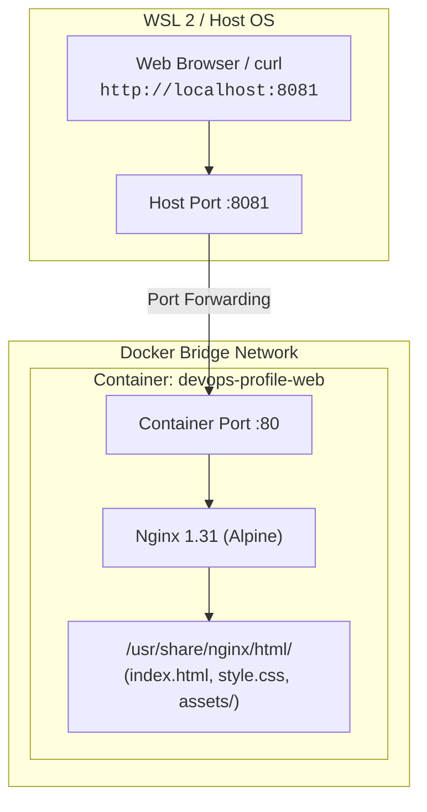

# 🐳 Containerization & Local Testing with Docker & Compose

This document details the containerization process of the static profile website using **Docker** and **Docker Compose**, covering Dockerfile layer caching, port mapping, container logs inspection, and HTTP response validation.

---

## 1. Containerization Architecture



---

## 2. Dockerfile & Image Build Optimization

### The `Dockerfile`
```dockerfile
FROM nginx:alpine

COPY website/ /usr/share/nginx/html/

EXPOSE 80
```

### Key Engineering Decisions:
1. **Base Image (`nginx:alpine`)**:
   - Uses **Alpine Linux** instead of Debian/Ubuntu.
   - Drastically reduces image size from ~180MB down to **~40MB**.
   - Smaller attack surface and fewer CVE vulnerabilities, meeting production security standards.
2. **Layer Caching (`COPY website/ /usr/share/nginx/html/`)**:
   - Copies static assets into Nginx's default document root for Alpine.
   - Docker caches unchanged layers; subsequent rebuilds take milliseconds (`CACHED [2/2]`).
3. **`EXPOSE 80`**:
   - Serves as documentation indicating the container listens on port 80 at runtime.

---

## 3. Orchestration with Docker Compose (`compose.yaml`)

```yaml
services:
  website:
    build:
      context: .
      dockerfile: Dockerfile
    image: devops-profile-website:1.0
    container_name: devops-profile-web
    ports:
      - "8081:80"
    restart: unless-stopped
```

### Breakdown of Compose Directives:
- **`build`**: Specifies the build context (`.`) and Dockerfile path.
- **`image: devops-profile-website:1.0`**: Automatically tags the built image with a semantic version.
- **`container_name: devops-profile-web`**: Assigns a human-readable container name instead of random hashes.
- **`ports: ["8081:80"]`**: Maps **Host port 8081** to **Container port 80**. This prevents collisions if the host machine or WSL is already running a local web server on port 80.
- **`restart: unless-stopped`**: Automatically restarts the container if Docker or the host daemon restarts.

---

## 4. Command Execution & Diagnostic Walkthrough

### 1. Build and Run Containers
```bash
docker compose up -d --build
```
- **Output Analysis**:
  ```text
  [+] up 3/3
   ✔ Image devops-profile-website:1.0      Built     4.3s
   ✔ Network ..._default                  Created   0.1s
   ✔ Container devops-profile-web          Started   0.5s
  ```
- Creates an isolated bridge network and starts the container in detached mode (`-d`).

---

### 2. Verify Container Runtime Status

#### General Docker Process Check:
```bash
docker ps
```
```text
CONTAINER ID   IMAGE                        STATUS          PORTS
7cd2dc31a40d   devops-profile-website:1.0   Up 14 seconds   0.0.0.0:8081->80/tcp, [::]:8081->80/tcp   devops-profile-web
```

#### Compose-Scoped Process Check:
```bash
docker compose ps
```
```text
NAME                 IMAGE                        STATUS          PORTS
devops-profile-web   devops-profile-website:1.0   Up 20 seconds   0.0.0.0:8081->80/tcp, [::]:8081->80/tcp
```
- **Port Binding**: Shows the container is bound to all host interfaces (`0.0.0.0` IPv4 and `[::]` IPv6) on port 8081.

---

### 3. Inspect Live Container Logs (`docker compose logs`)

```bash
docker compose logs --tail=30 website
```

#### What the Logs Reveal:
1. **Alpine Startup Entrypoint**:
   - `10-listen-on-ipv6-by-default.sh`: Configured IPv6 support.
   - `30-tune-worker-processes.sh`: Dynamically adjusted worker processes to match host CPU cores.
2. **Nginx Core Initialization**:
   - `using the "epoll" event method`: High-performance Linux asynchronous I/O.
   - `start worker process 30 ... 41`: Multi-worker architecture handling concurrent requests.
3. **Real Client Traffic Logs**:
   ```text
   172.18.0.1 - - [18/Oct/2026:07:31:14 +0000] "GET / HTTP/1.1" 200 10880
   172.18.0.1 - - [18/Oct/2026:07:31:14 +0000] "GET /style.css HTTP/1.1" 200 11944
   172.18.0.1 - - [18/Oct/2026:07:31:14 +0000] "GET /assets/profile.jpg HTTP/1.1" 200 702724
   172.18.0.1 - - [18/Oct/2026:07:31:14 +0000] "GET /assets/cover.jpg HTTP/1.1" 200 920641
   ```
   - Status code `200` confirms all HTML, CSS, and image assets were found and served.
   - Client IP `172.18.0.1` is the Docker bridge gateway communicating with the host.
4. **404 Handling**:
   - `GET /favicon.ico HTTP/1.1" 404`: Typical browser probe when no dedicated favicon file is present.

---

### 4. Validate Endpoint with `curl -I`

```bash
curl -I http://localhost:8081
```

#### Output:
```text
HTTP/1.1 200 OK
Server: nginx/1.31.7
Date: Sun, 18 Oct 2026 07:35:30 GMT
Content-Type: text/html
Content-Length: 10880
Last-Modified: Tue, 13 Oct 2026 18:12:26 GMT
Connection: keep-alive
ETag: "6ace748a-2a80"
Accept-Ranges: bytes
```

#### Diagnostic Breakdown:
- **`HTTP/1.1 200 OK`**: Successfully contacted the web server through host port 8081.
- **`Server: nginx/1.31.7`**: Confirms response originated from the Alpine container image.
- **`Content-Length: 10880`**: Exact byte size of `website/index.html`.

---

## 5. Docker Command Cheat Sheet

| Command | Description |
|---|---|
| `docker compose up -d --build` | Build images and start containers in the background |
| `docker compose ps` | View status of services managed by Compose |
| `docker compose logs -f website` | Follow live container logs |
| `docker compose logs --tail=50 website` | View last 50 log lines |
| `docker compose down` | Stop containers and remove networks |
| `docker compose restart website` | Restart the web container |
| `docker exec -it devops-profile-web sh` | Open an interactive shell inside the Alpine container |
