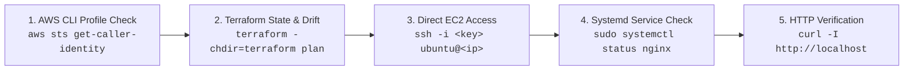

# 🚀 Infrastructure Verification & Connection Workflow

This document records the end-to-end command sequence used to verify AWS IAM credentials, validate Terraform state and drift from the project root, and establish a secure SSH connection to the provisioned EC2 instance.

---

## 📋 End-to-End Verification Pipeline



---

## 1. Step 1: Verify AWS Identity & Named Profile

Before running Terraform, always confirm your terminal is authenticated to the correct AWS account and IAM user.

### Command
```bash
aws sts get-caller-identity --profile terraform-devops
```

### Breakdown of Arguments
- `aws sts get-caller-identity`: Calls the AWS **Security Token Service (STS)** to retrieve details about the current IAM credentials.
- `--profile terraform-devops`: Specifies the named profile configured in `~/.aws/credentials` and `~/.aws/config`, ensuring you don't accidentally run commands against the default account.

### Actual Output
```json
{
    "UserId": "AIDAUSDSIYALUJ6EEYQSJ",
    "Account": "313772261399",
    "Arn": "arn:aws:iam::313772261399:user/terraform-devops-user"
}
```

### Why This Matters (DevOps Best Practice)
- **Account Isolation**: Prevents accidental deployments to production or wrong environments by confirming the AWS Account ID (`313772261399`).
- **Least Privilege Audit**: Verifies that the active identity is the dedicated IAM user (`terraform-devops-user`) rather than the root account.

---

## 2. Step 2: Validate Infrastructure State & Drift Detection

Run Terraform directly from the project root without needing to `cd` into the `terraform/` directory.

### Command
```bash
terraform -chdir=terraform plan
```

### Breakdown of Arguments
- `-chdir=terraform`: Instructs Terraform to switch its working directory to `./terraform` before executing. This keeps your terminal at the project root while executing IaC commands.
- `plan`: Refreshes state against real AWS resources and calculates what needs to be created, modified, or destroyed.

### Interactive Variable Prompt
```text
var.ssh_allowed_cidr
  Your public IPv4 address in CIDR notation, restricted to /32

  Enter a value: 13.229.12.38/32
```
> [!NOTE]
> Enter your current public IP address followed strictly by `/32` with **no leading spaces**. To skip this interactive prompt, define `ssh_allowed_cidr = "13.229.12.38/32"` in `terraform/terraform.tfvars`.

### Execution Output
```text
aws_key_pair.deployer: Refreshing state... [id=aws-devops-automation-key]
aws_vpc.main: Refreshing state... [id=vpc-0a747b651a7bca581]
data.aws_ami.ubuntu: Reading...
data.aws_ami.ubuntu: Read complete after 3s [id=ami-02a9cdd4e98bc3c78]
aws_internet_gateway.main: Refreshing state... [id=igw-0f0d1e4810c4bc30b]
aws_subnet.public: Refreshing state... [id=subnet-0a9156d5710c90e6c]
aws_security_group.web: Refreshing state... [id=sg-0c806a5672e44893b]
aws_instance.web: Refreshing state... [id=i-0f20105fab01dc90e]
aws_route_table.public: Refreshing state... [id=rtb-03aca5cad6fbdb0dc]
aws_route_table_association.public: Refreshing state... [id=rtbassoc-05ad4ad826051fa59]

No changes. Your infrastructure matches the configuration.
```

### Why This Matters (DevOps Best Practice)
- **Zero Configuration Drift**: "No changes" confirms that the real-world AWS infrastructure exactly matches the declarative HCL code.
- **Provider Multi-Resource Refresh**: Verifies that Terraform can read state across VPC, Subnet, Route Table, IGW, Security Group, SSH Key, and EC2 instance using the `terraform-devops` profile.

---

## 3. Step 3: Secure SSH Access to the Provisioned EC2 Instance

Once Terraform confirms the EC2 instance is running and healthy, connect via SSH using your private key.

### Command
```bash
ssh -i ~/.ssh/aws-devops-automation ubuntu@35.173.190.241
```

### Breakdown of Arguments
- `-i ~/.ssh/aws-devops-automation`: Specifies the path to the private SSH key corresponding to the public key injected by `aws_key_pair.deployer`.
- `ubuntu`: The default administrative non-root username for official Ubuntu cloud AMIs.
- `35.173.190.241`: The public IPv4 address assigned to the EC2 instance in the public subnet.

### Terminal Output
```text
Welcome to Ubuntu 24.04.5 LTS (GNU/Linux 7.0.0-1014-aws x86_64)

 * Documentation:  https://help.ubuntu.com
 * Management:     https://landscape.canonical.com
 * Support:        https://ubuntu.com/pro

 System information as of Sat Oct 17 17:55:52 UTC 2026

  System load:  0.0               Temperature:           -273.1 C
  Usage of /:   33.7% of 6.71GB   Processes:             119
  Memory usage: 28%               Users logged in:       0
  Swap usage:   0%                IPv4 address for ens5: 10.0.1.225

Last login: Sat Oct 17 17:03:46 2026 from 13.229.12.38
ubuntu@ip-10-0-1-225:~$
```

### What Successful Connection Proves
Connecting via SSH is the ultimate test proving that the entire cloud networking architecture is functioning properly:
1. **Public IP Routing**: The instance has a route out to the Internet through the **Internet Gateway (IGW)**.
2. **Route Table**: The public route table correctly maps `0.0.0.0/0` $\rightarrow$ `igw-0f0d1e4810c4bc30b`.
3. **Security Group Filter**: The Security Group ingress rule permits TCP port 22 specifically from your workstation IP (`13.229.12.38/32`).
4. **Key Pair Ingestion**: Cloud-init successfully injected your public key into `/home/ubuntu/.ssh/authorized_keys`.
5. **Private VPC Address**: The terminal prompt `ubuntu@ip-10-0-1-225` confirms the instance is running inside the intended subnet range (`10.0.1.0/24`).

---

## 4. Step 4: Verify Nginx Web Server Service Status (`systemctl`)

Once logged into the EC2 instance via SSH, check whether the Nginx daemon deployed by Ansible is active, running, and enabled.

### Command
```bash
sudo systemctl status nginx --no-pager
```

### Breakdown of Arguments
- `sudo`: Runs systemd query with administrative privileges to read all log lines.
- `systemctl status nginx`: Inspects the active unit file, service status, memory footprint, PID, and recent journalctl log entries.
- `--no-pager`: Forces `systemctl` to output raw text directly to terminal standard output without piping into `less` (prevents screen pause).

### Actual Output
```text
● nginx.service - A high performance web server and a reverse proxy server
     Loaded: loaded (/usr/lib/systemd/system/nginx.service; enabled; preset: enabled)
     Active: active (running) since Sat 2026-10-17 16:29:45 UTC; 1h 43min ago
       Docs: man:nginx(8)
    Process: 2136 ExecStartPre=/usr/sbin/nginx -t -q -g daemon on; master_process on; (code=exited, status=0/SUCCESS)
    Process: 2138 ExecStart=/usr/sbin/nginx -g daemon on; master_process on; (code=exited, status=0/SUCCESS)
    Process: 3171 ExecReload=/usr/sbin/nginx -g daemon on; master_process on; -s reload (code=exited, status=0/SUCCESS)
   Main PID: 2167 (nginx)
      Tasks: 3 (limit: 627)
     Memory: 2.7M (peak: 5.5M)
        CPU: 51ms
     CGroup: /system.slice/nginx.service
             ├─2167 "nginx: master process /usr/sbin/nginx -g daemon on; master_process on;"
             ├─3172 "nginx: worker process"
             └─3173 "nginx: worker process"

Oct 17 16:29:45 ip-10-0-1-225 systemd[1]: Starting nginx.service - A high performance web server and a reverse proxy server...
Oct 17 16:29:45 ip-10-0-1-225 systemd[1]: Started nginx.service - A high performance web server and a reverse proxy server.
Oct 17 16:38:05 ip-10-0-1-225 systemd[1]: Reloading nginx.service - A high performance web server and a reverse proxy server...
Oct 17 16:38:05 ip-10-0-1-225 nginx[3171]: 2026/10/17 16:38:05 [notice] 3171#3171: signal process started
Oct 17 16:38:05 ip-10-0-1-225 systemd[1]: Reloaded nginx.service - A high performance web server and a reverse proxy server.
```

### Key Diagnostic Indicators
1. **`Loaded: loaded (...; enabled)`**: Nginx is registered with systemd to start automatically if the server reboots.
2. **`Active: active (running)`**: The server process is currently running and accepting connections.
3. **`ExecReload: ... status=0/SUCCESS`**: Confirms Ansible's handler (`Reload nginx`) successfully signaled the master process without dropping traffic.
4. **Master and Worker Processes**: PID 2167 (master process) manages worker processes 3172 and 3173 to handle client connections.

---

## 5. Step 5: Test Web Server HTTP Response (`curl -I`)

After confirming the service is running, test the local HTTP endpoint to ensure Nginx serves the website with correct HTTP headers.

### Command
```bash
curl -I http://localhost
```

### Breakdown of Arguments
- `curl`: Client URL request utility.
- `-I` (or `--head`): Sends an HTTP **HEAD** request instead of GET. This requests only the HTTP response headers without downloading the full HTML body payload (ideal for quick diagnostic checks).
- `http://localhost`: Queries port 80 directly on the local loopback interface.

### Actual Output
```text
HTTP/1.1 200 OK
Server: nginx/1.24.0 (Ubuntu)
Date: Sat, 17 Oct 2026 18:13:52 GMT
Content-Type: text/html
Content-Length: 10880
Last-Modified: Sat, 17 Oct 2026 16:30:09 GMT
Connection: keep-alive
ETag: "6ad3a291-2a80"
Accept-Ranges: bytes
```

### What This Output Verifies
1. **`HTTP/1.1 200 OK`**: Nginx successfully found and served the root file (`/var/www/html/index.html`).
2. **`Content-Length: 10880`**: The delivered payload matches the exact byte size of `website/index.html` (10,880 bytes), proving Ansible successfully copied the static website files.
3. **`Server: nginx/1.24.0 (Ubuntu)`**: Identifies the web server software and operating system version.
4. **`ETag: "6ad3a291-2a80"`**: Entity tag header used by web browsers for caching static assets.

---

## 6. Quick Reference Cheat Sheet

| Task | Command | Environment |
|---|---|---|
| Verify active IAM caller identity & profile | `aws sts get-caller-identity --profile terraform-devops` | Local / WSL |
| Format Terraform code from root | `terraform -chdir=terraform fmt` | Local / WSL |
| Validate syntax from root | `terraform -chdir=terraform validate` | Local / WSL |
| Check for state drift from root | `terraform -chdir=terraform plan` | Local / WSL |
| Apply infrastructure changes from root | `terraform -chdir=terraform apply` | Local / WSL |
| SSH into instance using private key | `ssh -i ~/.ssh/aws-devops-automation ubuntu@<PUBLIC_IP>` | Local / WSL |
| Check Nginx service status (no pager) | `sudo systemctl status nginx --no-pager` | Remote EC2 |
| Verify HTTP response headers locally | `curl -I http://localhost` | Remote EC2 |
| Test website from control machine | `curl -I http://<PUBLIC_IP>` | Local / WSL |
